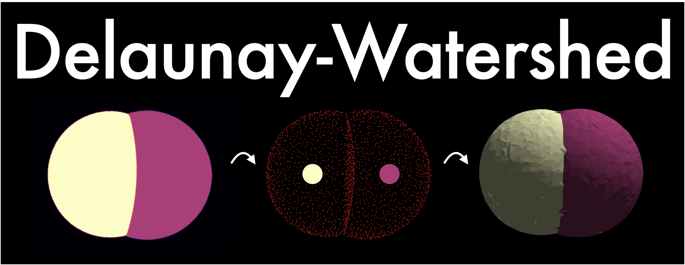
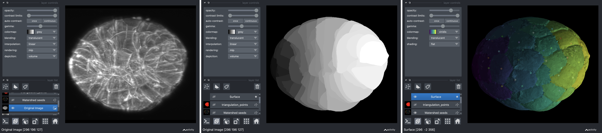
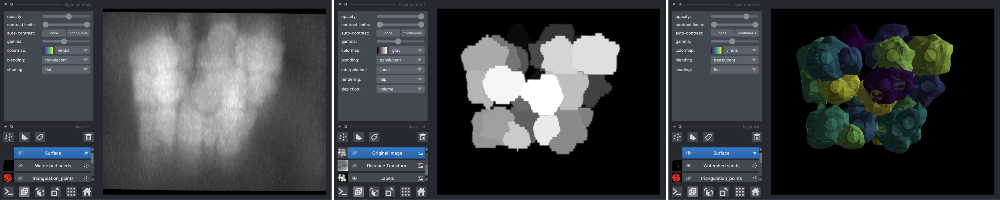

# Delaunay-Watershed (3D and 2D)

[![GPL-3.0-or-later][gpl-shield]][gpl] [](https://zenodo.org/badge/latestdoi/634561229)



**Delaunay-Watershed-3D** (package `dw3d`) reconstructs, from a 3-D instance segmentation of cells or nuclei, a **multimaterial surface mesh**: one triangle mesh of every interface between two cells, or between a cell and the medium. Such meshes are small, and suited to storage, sharing, geometric analysis and visualisation. It is the reconstruction behind [foambryo](https://github.com/VirtualEmbryo/foambryo), which infers surface tensions and cell pressures from these meshes. A viewer based on [Polyscope](https://polyscope.run) is included.

Delaunay-Watershed was created by Sacha Ichbiah during his PhD in [Turlier Lab](https://www.turlierlab.com), and is improved and maintained by Matthieu Perez and Hervé Turlier. For support, please open an issue. If you use it in your work, please cite both articles: Ichbiah S., Delbary F., McDougall A., Dumollard R., Turlier H. *Embryo mechanics cartography: inference of 3D force atlases from fluorescence microscopy.* Nature Methods **20**(12), 1989–1999 (2023), [doi:10.1038/s41592-023-02084-7](https://doi.org/10.1038/s41592-023-02084-7); and Yamamoto K., Ichbiah S., Perez M., Borrego-Pinto J., Delbary F., Goehring N. W., Northrop P., Turlier H., Charras G. *Spatiotemporal mapping of the contractile and adhesive forces sculpting early C. elegans embryos.* Developmental Cell **61**(6), 1273–1288.e4 (2026), [doi:10.1016/j.devcel.2026.04.013](https://doi.org/10.1016/j.devcel.2026.04.013).

Since 0.8.0 this repository also holds **Delaunay-Watershed-2D** (package `dw2d`, distribution `delaunay-watershed-2d`), which reconstructs a multimaterial polygonal mesh of the interfaces of a 2-D label image; it too was created by Sacha Ichbiah and is maintained by Matthieu Perez and Hervé Turlier. The same calls mesh a 2-D or a 3-D mask: the input decides the dimension (see [In 2D](#in-2d) below, and dw2d's own page, [`docs/two_dimensional/README.md`](docs/two_dimensional/README.md)).

The documentation (user guide, examples, API reference) is in [`docs/`][docs]; the full list of changes is in the [CHANGELOG][changelog], and what can mislead you in the [release notes][notes].

## What's new in 0.8.0

- **2D and 3D with the same calls.** `construct_mesh_from_segmentation_mask` and `construct_mesh_in_physical_units` take a 2-D label image as well as a 3-D one: dw3d hands a 2-D mask to dw2d and returns its mesh, `(points (n, 2), segments (m, 2), labels (m, 2))`. dw2d offers dw3d's names (`dw2d.get_default_mesh_reconstruction_algorithm`, `MeshReconstructionAlgorithmFactory`, `save_to_rec_mesh`, the compressed segmentation, `reconstruct_mask_from_dict`), and `.rec` files record their dimension. The default point spacing stays 3 voxels in 3D and 4 pixels in 2D.
- **dw2d joins this repository, in three distributions under one version.** `delaunay-watershed` (new, no code) installs `delaunay-watershed-3d` (`dw3d`) and `delaunay-watershed-2d` (`dw2d`); the imports are unchanged. dw2d is now under GPL-3.0-or-later, like dw3d, and runs on NumPy 2 and SciPy 1.14 or later. Its defaults change results: a mesh that is the same on every machine, junctions moved onto the mask's own junctions, pinch vertices repaired, image-border vertices marked; its lengths and curvatures are fixed. Coming from dw2d 0.1.5: see [the migration page][migration].
- **One orientation rule in 2D and 3D**: each triangle or edge is the positively oriented boundary of its first label in the mask's index frame. dw3d's triangles do not change; dw2d's edges are stored the other way round from 0.1.5. See [orientation][orientation].
- **A cell a few voxels from the image box no longer takes the medium between them.** Thin margins of medium on faces no cell reaches are padded before meshing (masks of cubic voxels; a mask resampled from longer voxels is not padded unless asked), and `ThinMediumMarginWarning` names a cell left on a face it does not reach. 18 of 684 test masks change; the 47 benchmark masks are meshed bit for bit as before. See [thin medium margins][margins].
- **Every label absent from the mesh is named**, whatever the cause (`UnresolvedCellWarning`, `UnresolvedRegion.cause`), including a cell the seeded watershed loses, a known issue described in [cropped tissues][cropped].
- **`reconstruct_mask_from_dict` rebuilds a mask exactly from the mesh's triangles**: agreement with the original mask 99.19–99.73 % (98.44–99.32 % before) on 51 masks, in 0.3–1.1 s instead of 5–10 s; trimesh is no longer a dependency.
- **The `.rec` format is read and written by iorec** (`iorec>=1.4.1`); the metadata appendix written stays version 1, which delaunay-watershed-3d 0.7.1 and foambryo 0.7.1 read in full. Python 3.12 or later.
- **The Polyscope viewer draws 2-D meshes** in a 2-D window (`plot_cells_polyscope`, with `image=` to draw the image under the mesh); the `viewing` extra needs Polyscope 2.5.0 or later.

## What's new in 0.7.1

- **The mesh no longer depends on the order in which Qhull returns the tetrahedra**; meshes change slightly (45 of the 47 benchmark meshes, by a median of 13 faces). `canonical_tetrahedron_order=False` reproduces 0.7.0's meshes on the same machine.
- **An enclosed pocket of medium (a lumen) is its own region**, flagged as a medium in the `.rec` file, instead of part of one cell; every piece of exterior gets its own seed; a region the tesselation cannot hold is named (`UnresolvedCellWarning`) instead of growing inside a neighbour. A mask with none of these is meshed bit for bit as before.
- **Mesh surgery no longer leaves abnormal non-manifold edges**, and a finished mesh that has some says so (`AbnormalEdgeWarning`).
- **The Polyscope viewer draws the tissue, not its mirror image.** No number changes.
- **The test suites run on Linux x86-64 CI** as well as on macOS; between machines, meshes may differ only at exactly cospherical points.

## What's new in 0.7.0

0.7.0 is the first release on PyPI since 0.5.1; it includes everything prepared for 0.6.0, which was not published.

- **Masks with voxels longer along z.** `algorithm.construct_mesh_in_physical_units(mask, spacing)` resamples the mask to cubic voxels before meshing and returns the mesh in physical units; the `.rec` file records the spacing.
- **Cropped tissues.** Where a cell reaches the image box, the triangles that close it there are marked as *crop faces*, and the cells they touch as *cut cells*; the files keep the marks. The mesh itself is unchanged.
- **Fixes that change results**: cells that touch the image border are closed by correctly wound triangles (they read too small a volume, often a negative one); a few triangles on flat tetrahedra are wound correctly; `set_pixel_size` now scales column 0 (z) by the z size — it used to swap z and x, so re-run any analysis that called it with different xy and z sizes.
- **New checks**: the cells whose mesh volume disagrees with their mask are listed (`cell_volume_report`, with a `CellVolumeDisagreementWarning`), and junction relocation can no longer turn a very small cell inside out.
- **Faster and lighter on large tissues** (the speed-ups change no mesh; 0.7.0's mesh of this tissue differs from 0.5.1's only by the fixes listed below: 2 vertex positions and 166 triangle windings): on a 1 866-cell tissue meshed on its native grid, from mask to tensions, 9.5 min instead of 47.5 min with 0.5.1, and a peak memory of 30.9 GiB instead of 54.7 GiB. Resampled to cubic voxels first (`construct_mesh_in_physical_units`), the same tissue's reconstruction takes about 13.5 min and 38 GiB.
- **A lighter distance transform and a faster tesselation graph, with bit-for-bit the same meshes.** On a 1 866-cell tissue the distance transform's peak memory goes from 21.0 to 14.9 GiB (38.1 to 28.1 GiB when the mask is first resampled to cubic voxels), the tesselation's face table and pairing take 1.8 s instead of 7.8 s and its graph 3.0 s instead of 5.5 s; a 2 000-cell synthetic foam is reconstructed in 186 s instead of 200 s. Contributed by Wenhong Li and Adam L. Taylor.

## Installation

Delaunay-Watershed needs Python 3.12 or later. Install it from PyPI, in a virtual environment:

```shell
pip install delaunay-watershed                  # dw3d and dw2d
pip install "delaunay-watershed[viewing]"       # and the viewers: Polyscope (dw3d), matplotlib (dw2d's figures)
```

`delaunay-watershed` holds no code: it installs `delaunay-watershed-3d` (package `dw3d`) and `delaunay-watershed-2d` (package `dw2d`) at its own version. `delaunay-watershed-3d` also requires `delaunay-watershed-2d` at the same version, so `pip install delaunay-watershed-3d` installs both packages too; `pip install delaunay-watershed-2d` installs `dw2d` alone.

Upgrading from `delaunay-watershed-3d` 0.7.1 or `delaunay-watershed-2d` 0.1.5 needs nothing special: `pip install --upgrade delaunay-watershed-3d` (or `-2d`, or `delaunay-watershed`) replaces the old release in place, because each package stays in the distribution that has always installed it.

For development, clone the repository and, from its folder, `pip install -e . -e ./distributions/delaunay-watershed-2d "./distributions/delaunay-watershed[viewing]"` (the root builds `delaunay-watershed-3d`; `distributions/` holds the other two). Tested for 0.8.0 on macOS on Apple silicon (arm64) and on Linux x86-64 (Ubuntu 24.04), with Python 3.12 and 3.13 (dw2d also 3.14), with the newest and the lowest supported versions of the dependencies; other systems are expected to work but were not tested for this release.

## Quick start

The input is a 3-D array of integer labels, one per cell, 0 for the medium; axis 0 is z. The mesh's points are in the same order, `(z, y, x)`.

```py
import tifffile
from dw3d import get_default_mesh_reconstruction_algorithm
from dw3d.viewing import plot_cells_polyscope

mask = tifffile.imread("segmentation.tif")
algorithm = get_default_mesh_reconstruction_algorithm()

# With the voxel size (dz, dy, dx): resampled to cubic voxels, mesh in um.
points, triangles, labels = algorithm.construct_mesh_in_physical_units(mask, spacing=(1.0, 0.5, 0.5), spacing_unit="um")
# Or on the voxel grid, mesh in voxel units:
# points, triangles, labels = algorithm.construct_mesh_from_segmentation_mask(mask)

algorithm.save_to_rec_mesh("mesh.rec")          # read it in foambryo with dcel_mesh_from_file
plot_cells_polyscope(algorithm)                 # needs [viewing] and a display
```

`points` are the vertices, `triangles` index them, and `labels` give the two materials on each side of each triangle, smaller first; each triangle's right-hand normal, in the mask's `(z, y, x)` frame, points out of its first label into its second. The notebooks in [`Examples/`][examples] show the rest.

## In 2D

A 2-D label image (an `(rows, columns)` array of integer labels, 0 for the medium) is meshed by the same calls; the mesh is a set of polygonal lines, one per interface:

```py
import tifffile
from dw3d import get_default_mesh_reconstruction_algorithm

mask = tifffile.imread("data/two_dimensional/Masks/mask_Cells_3.tif")
algorithm = get_default_mesh_reconstruction_algorithm()          # min_distance: 3 voxels in 3D, 4 pixels in 2D
points, segments, labels = algorithm.construct_mesh_from_segmentation_mask(mask)
algorithm.save_to_rec_mesh("mesh_2d.rec")                        # the file records dimension = 2
```

`points` `(n, 2)` are in the mask's `(row, column)` order, in pixels; `segments` `(m, 2)` index them; `labels` `(m, 2)` give the two materials each edge separates, smaller first, and the first lies on the left of each edge in `(row, column)`. The same mesh comes from dw2d's own names, which mirror dw3d's: `dw2d.get_default_mesh_reconstruction_algorithm().construct_mesh_from_segmentation_mask(mask)`; its `last_constructed_dcel` is the half-edge structure from which interface lengths, angles, curvatures and cell areas are read. `plot_cells_polyscope(algorithm, image=mask)` draws the mesh over the mask in a 2-D window. dw2d's options, its defaults and what each was measured to change are in the [2D user guide][two-d]; the notebooks in [`Examples/two_dimensional`][examples-2d] show a reconstruction, the geometry read from it and the mask rebuilt from it. foambryo infers tensions and pressures from these 2-D meshes.

## What the reconstruction does, and its options

- **The default reconstruction** is the published algorithm (equivalent to dw3d 0.3.6), the more accurate one for tension inference today. Other variants are opt-in, among them the deterministic, link-checked `get_link_checked_mesh_reconstruction_algorithm`, cleaner in topology but worse for tension inference. See [reconstruction variants][variants].
- **Junction relocation** (on by default since 0.5.0) moves the trijunction vertices onto the junction curves the mask gives, under a guard that can never make the mesh pass through itself; only vertices move. `algorithm.relocate_junctions = False` gives the 0.4 meshes. See [junction relocation][relocation].
- **Cropped tissues.** `algorithm.crop_faces` (a boolean per triangle), `algorithm.cut_cells` and `algorithm.crop_face_report`. A tissue that really ends on an image face (a coverslip): `algorithm.physical_image_faces = ("axis0_low",)`. See [cropped tissues][cropped].
- **Anisotropic voxels.** Measured on simulated tissues whose cells are as small as real ones, down-sampled along z, against the same tissues meshed at full resolution: resampling to cubic voxels first costs +0.83, +0.71 and +1.17 degrees of contact-angle error at a z/xy ratio of 5/3, 2 and 3, against +1.38, +1.97 and +4.10 for meshing the native grid and scaling the mesh (measured on 0.7.0's meshes, before 0.8.0 pads thin margins of medium on the native grid, and not measured again, because some of these runs need 8 to 40 GiB of memory). Above 3 nothing was measured, and `UnmeasuredAnisotropyWarning` says so. `min_distance` counts cubic voxels, so the cost is that of a mask acquired at the short spacing. See [anisotropic voxels][aniso].
- **Files.** `.rec`/`.arec` (text or binary) and `.vtk`; a `.rec` file can carry a metadata appendix that records the coordinate frame, the spacing and the crop faces. See [the metadata appendix][appendix]. Files keep the points' columns in the mask's order, `(z, y, x)`: a program that reads them as `(x, y, z)`, as ParaView, MeshLab and other VTK readers do, shows the mirror image of the tissue unless columns 0 and 2 are exchanged (and, to keep the triangles facing the same side, two corners of each triangle). The Polyscope viewer does this for what it draws.
- **Checks.** `cell_volume_report` lists the cells whose mesh volume is outside 0.5–1.5 times their voxel count; `count_self_intersections(points, triangles)` counts self-intersecting triangle pairs.

## Biological examples

### Cell interfaces in the *P. mammillata* embryo

See the notebook [*Mesh reconstruction and visualisation*](https://github.com/VirtualEmbryo/delaunay-watershed/blob/v0.8.0/Examples/example_1_mesh_reconstruction_visualisation.ipynb). Segmentation masks from [Guignard et al.](https://www.science.org/doi/10.1126/science.aar5663)



### Cell nuclei

See the notebook [*Mask compression and reconstruction*](https://github.com/VirtualEmbryo/delaunay-watershed/blob/v0.8.0/Examples/example_2_mask_compression_reconstruction.ipynb). Segmentation masks from [StarDist](https://github.com/stardist/stardist).



## Repository layout

The development repository also holds the project's research record (working notes, exploratory scripts and their results), for provenance. It is not part of the distribution: `pip install` does not ship it, and nothing under `dw3d` imports from it.

## Credits, contact, citation

If you use this tool, please cite both articles: Ichbiah S., Delbary F., McDougall A., Dumollard R., Turlier H. *Embryo mechanics cartography: inference of 3D force atlases from fluorescence microscopy.* Nature Methods **20**(12), 1989–1999 (2023), [doi:10.1038/s41592-023-02084-7](https://doi.org/10.1038/s41592-023-02084-7); and Yamamoto K., Ichbiah S., Perez M., Borrego-Pinto J., Delbary F., Goehring N. W., Northrop P., Turlier H., Charras G. *Spatiotemporal mapping of the contractile and adhesive forces sculpting early C. elegans embryos.* Developmental Cell **61**(6), 1273–1288.e4 (2026), [doi:10.1016/j.devcel.2026.04.013](https://doi.org/10.1016/j.devcel.2026.04.013). Contact Matthieu Perez and Hervé Turlier for practical questions and applications.

Recent work on dw3d and foambryo is part of a collaboration with Alejandro Aguilera Castrejon (Janelia Research Campus, Howard Hughes Medical Institute). We thank him and his Janelia colleagues Adam L. Taylor, Wenhong Li and Francesco Roncato. Adam L. Taylor found the border-triangle winding defect fixed in 0.6.0 and pointed us to the seed-extraction and dense tension-solve bottlenecks on large tissues.

```bibtex
@article{Ichbiah2023,
  author    = {Ichbiah, Sacha and Delbary, Fabrice and McDougall, Alex and Dumollard, R{\'e}mi and Turlier, Herv{\'e}},
  title     = {Embryo mechanics cartography: inference of {3D} force atlases from fluorescence microscopy},
  journal   = {Nature Methods},
  volume    = {20},
  number    = {12},
  pages     = {1989--1999},
  year      = {2023},
  month     = dec,
  publisher = {Springer Science and Business Media LLC},
  issn      = {1548-7105},
  doi       = {10.1038/s41592-023-02084-7},
  url       = {https://doi.org/10.1038/s41592-023-02084-7}
}
```

```bibtex
@article{Yamamoto2026,
  author    = {Yamamoto, Kazunori and Ichbiah, Sacha and Perez, Matthieu and Borrego-Pinto, Joana and Delbary, Fabrice and Goehring, Nathan W. and Northrop, Paul and Turlier, Herv{\'e} and Charras, Guillaume},
  title     = {Spatiotemporal mapping of the contractile and adhesive forces sculpting early {C. elegans} embryos},
  journal   = {Developmental Cell},
  volume    = {61},
  number    = {6},
  pages     = {1273--1288.e4},
  year      = {2026},
  doi       = {10.1016/j.devcel.2026.04.013},
  url       = {https://doi.org/10.1016/j.devcel.2026.04.013}
}
```

## Licence

Delaunay-Watershed is free software: you can redistribute it and modify it under the terms of the [GNU General Public License][gpl], version 3 or (at your option) any later version (SPDX `GPL-3.0-or-later`); the text is in `License`. This covers versions 0.5.0 and later; earlier releases keep the licence they were published under (CC BY-NC-SA 4.0).

[![GPLv3][gpl-image]][gpl]

[gpl]: https://www.gnu.org/licenses/gpl-3.0.html
[gpl-image]: https://www.gnu.org/graphics/gplv3-127x51.png
[gpl-shield]: https://img.shields.io/badge/License-GPLv3-blue.svg
[docs]: https://github.com/VirtualEmbryo/delaunay-watershed/blob/v0.8.0/docs/index.md
[changelog]: https://github.com/VirtualEmbryo/delaunay-watershed/blob/v0.8.0/CHANGELOG.md
[notes]: https://github.com/VirtualEmbryo/delaunay-watershed/blob/v0.8.0/RELEASE_NOTES.md
[examples]: https://github.com/VirtualEmbryo/delaunay-watershed/tree/v0.8.0/Examples
[variants]: https://github.com/VirtualEmbryo/delaunay-watershed/blob/v0.8.0/docs/user-guide/reconstruction-variants.md
[relocation]: https://github.com/VirtualEmbryo/delaunay-watershed/blob/v0.8.0/docs/user-guide/junction-relocation.md
[cropped]: https://github.com/VirtualEmbryo/delaunay-watershed/blob/v0.8.0/docs/user-guide/cropped-tissues.md
[aniso]: https://github.com/VirtualEmbryo/delaunay-watershed/blob/v0.8.0/docs/user-guide/anisotropic-voxels.md
[appendix]: https://github.com/VirtualEmbryo/delaunay-watershed/blob/v0.8.0/docs/user-guide/rec-metadata-appendix.md
[migration]: https://github.com/VirtualEmbryo/delaunay-watershed/blob/v0.8.0/docs/two_dimensional/migration-from-0.1.5.md
[orientation]: https://github.com/VirtualEmbryo/delaunay-watershed/blob/v0.8.0/docs/user-guide/orientation-in-two-and-three-dimensions.md
[margins]: https://github.com/VirtualEmbryo/delaunay-watershed/blob/v0.8.0/docs/user-guide/thin-medium-margins.md
[two-d]: https://github.com/VirtualEmbryo/delaunay-watershed/blob/v0.8.0/docs/two_dimensional/reconstruction.md
[examples-2d]: https://github.com/VirtualEmbryo/delaunay-watershed/tree/v0.8.0/Examples/two_dimensional
