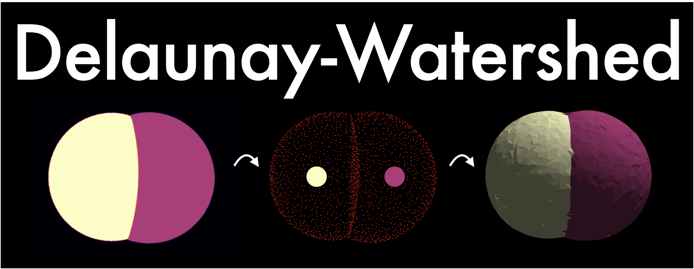
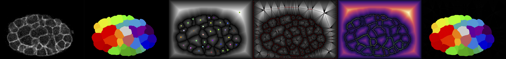
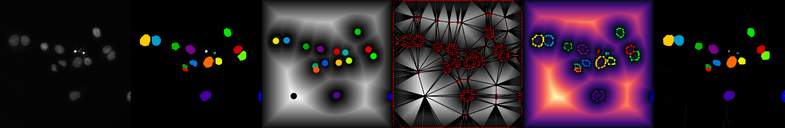

# Delaunay-Watershed 2D

[![GPL-3.0-or-later][gpl-shield]][gpl]



**Delaunay-Watershed-2D** (package `dw2d`, distribution `delaunay-watershed-2d`) reconstructs, from a 2-D instance segmentation of cells or nuclei, a **multimaterial polygonal mesh**: one polygonal line of every interface between two cells, or between a cell and the medium. Such meshes are small, and suited to storage, geometrical analysis, sharing and visualisation. The mesh is also built as a [half-edge](https://en.wikipedia.org/wiki/Doubly_connected_edge_list) structure, from which interface lengths, junction angles, curvatures and cell areas are read.

Delaunay-Watershed was created by Sacha Ichbiah during his PhD in [Turlier Lab](https://www.turlierlab.com), and is maintained by Matthieu Perez and Hervé Turlier. For support, please open an issue.

Since 0.8.0 dw2d is developed and released with dw3d, its 3-D counterpart, in the repository [VirtualEmbryo/delaunay-watershed](https://github.com/VirtualEmbryo/delaunay-watershed), under one version and one changelog; delaunay-watershed-2d 0.1.5 was its last release from its own repository. The two packages are used the same way: dw2d offers dw3d's names, and dw3d's algorithm given a 2-D mask hands it to dw2d. It is the reconstruction behind the 2-D inference of [foambryo](https://github.com/VirtualEmbryo/foambryo), which infers tensions and pressures from these meshes.

## Installation

```shell
pip install delaunay-watershed                  # dw2d and dw3d
pip install delaunay-watershed-2d               # dw2d alone
pip install "delaunay-watershed-2d[viewing]"    # with matplotlib, for dw2d's figures
```

dw2d needs Python 3.12 or later. The import is unchanged: `import dw2d`.

## Example

Load an instance segmentation, reconstruct its multimaterial mesh, and read its geometry:

```py
import tifffile
import dw2d

mask = tifffile.imread("data/two_dimensional/Masks/mask_Cells_3.tif")
algorithm = dw2d.get_default_mesh_reconstruction_algorithm()          # min_distance=4 pixels
points, segments, labels = algorithm.construct_mesh_from_segmentation_mask(mask)

mesh = algorithm.last_constructed_dcel                                # the half-edge structure
mesh.compute_lengths()        # interface -> length (px)
mesh.compute_angles()         # junction -> angles inside each cell (rad)
mesh.compute_curvatures()     # interface -> curvature (1/px, unsigned)
mesh.compute_area_faces()     # material -> area (px^2); the medium, 0, negative

algorithm.save_to_rec_mesh("mesh_2d.rec")                             # read back with dw2d.io.load_rec
```

`points` `(n, 2)` are in the mask's `(row, column)` order, in pixels; `segments` `(m, 2)` index them; `labels` `(m, 2)` give the two materials each edge separates, smaller first. Each edge is the positively oriented boundary of its first label: `labels[k, 0]` lies on the left of `segments[k, 0] -> segments[k, 1]` in `(row, column)`, the rule dw3d's triangles follow too (since 0.8.0; dw2d 0.1.5 stored every edge the other way round).

## Options and defaults

`dw2d.MeshReconstructionAlgorithmFactory` builds an algorithm step by step, with dw3d's names where they have a 2-D meaning: `set_peak_local_points_placement_method(min_distance)`, `set_junction_relocation`, `set_canonical_triangle_order`, and the 2-D-only `set_interface_projection`, `set_pinch_vertex_repair`, `set_near_tie_sliver_relabelling`, `set_label_expansion`, `set_score_samples`; `make_algorithm()` builds it. Since 0.8.0 the defaults give a mesh that is the same on every machine, move the junctions onto the mask's own junctions, repair pinch vertices, mark the vertices on the image border, and pad thin margins of medium; each changes results and each can be turned off. The documentation's 2-D section lists every option with what it was measured to change, and how to get dw2d 0.1.5's mesh back:

* [Reconstruction in 2D](https://github.com/VirtualEmbryo/delaunay-watershed/blob/v0.8.0/docs/two_dimensional/reconstruction.md)
* [Migrating from dw2d 0.1.5](https://github.com/VirtualEmbryo/delaunay-watershed/blob/v0.8.0/docs/two_dimensional/migration-from-0.1.5.md)

**Deprecated names.** `geometry_reconstruction_2d` (and its `return_mesh`, `return_dcel`, `export_mesh`, `export_segmentation`), the `.rec` readers and writers of 0.1.5 (`read_rec_file_bin`, `read_rec_file_num`, `open_mesh_multitracker`, `write_mesh_bin`, `write_mesh_text`) and the other names 0.1.5 exported from its top level still work through 0.8.x, with a `DeprecationWarning` naming their replacement or their module; they will be removed in 0.9.

**Fixed in 0.8.0.** `compute_lengths` and `compute_curvatures` were wrong on most interfaces in 0.1.5 (the lengths by a median 7.4 %): recompute any length or curvature obtained with it.

## Notebooks

In [`Examples/two_dimensional/`](https://github.com/VirtualEmbryo/delaunay-watershed/tree/v0.8.0/Examples/two_dimensional): the geometrical analysis of a mesh (`Geometrical_analysis.ipynb`), and the compression of a mask into its mesh and seeds, then its reconstruction, on a tissue (`Geometry_and_mask_reconstruction_2.ipynb`) and on separated cells (`Geometry_and_mask_reconstruction_1.ipynb`).

## Biological use-cases

### Geometrical reconstruction of a *C. elegans* embryo

Data from [CShaper](https://cao13jf.github.io/cshaperpage/).



### Geometrical reconstruction of cell nuclei

Data from the [2018 Data Science Bowl](https://www.kaggle.com/c/data-science-bowl-2018).



## Credits, contact, citation

If you use dw2d, please cite: Yamamoto K., Ichbiah S., Perez M., Borrego-Pinto J., Delbary F., Goehring N. W., Northrop P., Turlier H., Charras G. *Spatiotemporal mapping of the contractile and adhesive forces sculpting early C. elegans embryos.* Developmental Cell **61**(6), 1273–1288.e4 (2026), [doi:10.1016/j.devcel.2026.04.013](https://doi.org/10.1016/j.devcel.2026.04.013). Contact Matthieu Perez and Hervé Turlier for practical questions and applications.

## Licence

dw2d is free software: you can redistribute it and modify it under the terms of the [GNU General Public License][gpl], version 3 or (at your option) any later version (SPDX `GPL-3.0-or-later`), like dw3d, with the agreement of its authors; the text is in the repository's `License`. This covers delaunay-watershed-2d 0.8.0 and later; dw2d 0.1.5 and earlier keep the licence they were published under.

[gpl]: https://www.gnu.org/licenses/gpl-3.0.html
[gpl-shield]: https://img.shields.io/badge/License-GPLv3-blue.svg
