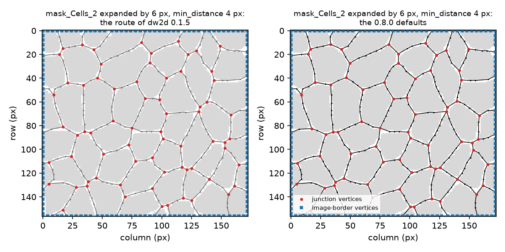

# Migrating from dw2d 0.1.5

delaunay-watershed-2d 0.1.5 was the last release of dw2d from its own repository. From 0.8.0 dw2d is developed and released with dw3d, under one version. Code written for 0.1.5 still runs through 0.8.x, with deprecation warnings, but its meshes and some of its numbers change: this page lists what changes and how to get the former behaviour back.

If you use dw2d, please cite: Yamamoto K., Ichbiah S., Perez M., Borrego-Pinto J., Delbary F., Goehring N. W., Northrop P., Turlier H., Charras G. *Spatiotemporal mapping of the contractile and adhesive forces sculpting early C. elegans embryos.* Developmental Cell **61**(6), 1273–1288.e4 (2026), [doi:10.1016/j.devcel.2026.04.013](https://doi.org/10.1016/j.devcel.2026.04.013).

## Installation and licence

```shell
pip install delaunay-watershed            # dw3d and dw2d
pip install delaunay-watershed-2d         # dw2d alone, as before
```

`pip install --upgrade delaunay-watershed-2d` replaces 0.1.5 in place. The import is unchanged (`import dw2d`). dw2d 0.8.0 needs Python 3.12 or later, NumPy 2.0, SciPy 1.13 (it runs on SciPy 1.14 and later, which removed `interp2d`), scikit-image 0.23.1, networkx 2.8 and iorec 1.4.1; matplotlib only for figures (`pip install "delaunay-watershed-2d[viewing]"`), and no longer Polyscope. dw2d is licensed under GPL-3.0-or-later from 0.8.0, like dw3d; 0.1.5 and earlier keep the licence they were published under.

## The new names

The 0.1.5 call and its 0.8.0 equivalent:

```py
# 0.1.5 (still works through 0.8.x, with a DeprecationWarning)
from dw2d import geometry_reconstruction_2d
DW = geometry_reconstruction_2d(labels, min_dist=4, expansion_labels=0)
verts, edges = DW.return_mesh()           # edges: (m, 4) [v1, v2, m1, m2]
mesh = DW.return_dcel()
DW.export_mesh("mesh.rec", mode="txt")
DW.export_segmentation("compressed.npy")

# 0.8.0
import dw2d
algorithm = dw2d.get_default_mesh_reconstruction_algorithm(min_distance=4)
points, segments, labels = algorithm.construct_mesh_from_segmentation_mask(labels_image)
mesh = algorithm.last_constructed_dcel
algorithm.save_to_rec_mesh("mesh.rec")
dw2d.save_compressed_segmentation("compressed.npy", algorithm.last_compressed_segmentation)
```

| 0.1.5 | 0.8.0 |
|---|---|
| `geometry_reconstruction_2d(labels, min_dist=…, expansion_labels=…, interpolation_points=…)` | `get_default_mesh_reconstruction_algorithm(min_distance=…)`, or the factory's `set_peak_local_points_placement_method`, `set_label_expansion`, `set_score_samples` |
| `deterministic=` (development versions only) | `set_canonical_triangle_order` / `canonical_triangle_order` |
| `relocate_junctions=`, `project_interface_vertices=`, `repair_pinch_vertices=`, `relabel_near_tie_slivers=` (development versions only) | `set_junction_relocation`, `set_interface_projection`, `set_pinch_vertex_repair`, `set_near_tie_sliver_relabelling` |
| `DW.return_mesh()` → `(verts, edges)`, `edges` `(m, 4)` | `construct_mesh_from_segmentation_mask(mask)` → `(points, segments, labels)`, as dw3d |
| `DW.return_dcel()` | `algorithm.last_constructed_dcel` |
| `DW.export_mesh(filename, mode)` | `algorithm.save_to_rec_mesh(filename, binary_mode=False)` |
| `DW.export_segmentation(filename)` | `algorithm.last_compressed_segmentation`, `dw2d.save_compressed_segmentation` |
| `reconstruct_mask_from_dict(filename)` | `reconstruct_mask_from_dict(dictionary)`, `reconstruct_mask_from_saved_file_dict(filename)` |
| `read_rec_file_bin`, `read_rec_file_num`, `open_mesh_multitracker` (in `dw2d.Dcel`) | `dw2d.io.load_rec(filename)` → `(points, segments, labels)` |
| `write_mesh_bin`, `write_mesh_text` (in `dw2d.Dcel`) | `dw2d.io.save_rec(filename, points, segments, labels, binary_mode=False)` |
| `DW.simple_plot()`, `DW.plot_polylines_and_seeds()` | the same methods on the algorithm, or `dw3d.viewing.plot_cells_polyscope(algorithm, image=mask)` |
| relocation and projection functions returning a dictionary | `relocate_junction_vertices(mask, points, segments, labels, ...)`, `project_interface_vertices(mask, points, segments, labels, ...)`, returning `JunctionRelocationReport` and `InterfaceProjectionReport` |

**Deprecated names, kept through 0.8.x and removed in 0.9.** `geometry_reconstruction_2d` (with `min_dist`, `return_mesh`, `return_dcel`, `export_mesh`, `export_segmentation` and its plotting methods) warns once, when constructed, and computes exactly as before. The `.rec` readers and writers of 0.1.5 call the new functions, return what they returned before and warn. Every other name 0.1.5 exported from its top level (the half-edge and plotting helpers of `dw2d.Dcel`, `trace_line`, `Delaunay_Graph`, `seeded_watershed_map`, the helpers of `dw2d.Plotting_tools`, …) still resolves, with a `DeprecationWarning` naming its module. `reconstruct_mask_from_dict` given a file name warns and reads the file. The third-party names that 0.1.5's star imports leaked (`dw2d.np`, `dw2d.plt`, `dw2d.pickle`, …) are gone; import them yourself. `open_mesh_multitracker` no longer has a default file name and detects the layout itself. `export_mesh` with a mode other than `'bin'` or `'txt'` raises `ValueError` (it printed a message and wrote nothing).

## Defaults that change results

Every one of these changes the mesh of some masks; each is on in 0.8.0, and each can be turned off. Their measured effects are in the [2D user guide](reconstruction.md).

| default | what changes | how to turn it off |
|---|---|---|
| a machine-independent route (canonical triangle order) | cells of four or more cocircular points are triangulated by a fixed rule: 2 of the 18 golden cases change, by about 0.05 % of one interface length | `set_canonical_triangle_order(False)` |
| junction relocation | every junction vertex moves onto the mask's own junction, by a fraction of a pixel | `set_junction_relocation(False)` |
| pinch-vertex repair | a few triangles are relabelled where a cell or a material was split around one vertex; meshes whose half-edge structure 0.1.5 could not build now build | `set_pinch_vertex_repair(False)` |
| near-tie sliver relabelling | on the route without relocation, Z-shaped folds along membranes are removed; off with relocation, so off by default | `set_near_tie_sliver_relabelling(False)` |
| image-border vertices marked | the vertices on the image border are never moved by the relocation or the projection; 7 of 972 border junctions on 82 test meshes stay on the border instead of moving inside the image | (always on) |
| thin margins of medium padded | a cell a few pixels from a side no cell reaches no longer takes the margin; none of the shipped masks is padded | `pad_thin_medium_margins = False` |

**0.1.5's mesh, as nearly as it can be had:**

```py
algorithm = (
    dw2d.MeshReconstructionAlgorithmFactory()
    .set_canonical_triangle_order(False)
    .set_junction_relocation(False)
    .set_pinch_vertex_repair(False)
    .set_near_tie_sliver_relabelling(False)
    .make_algorithm()
)
algorithm.pad_thin_medium_margins = False
```

Its vertices are 0.1.5's on the same machine (the legacy triangulation of cocircular points depends on the machine, as it did), and its edges are stored in the 0.8.0 orientation (below).



*One shipped mask, `data/two_dimensional/Masks/mask_Cells_2.tif` (157 × 173 pixels, 50 cells), its labels expanded by 6 pixels (`set_label_expansion(6)`) so that the cells touch, at `min_distance` 4 pixels: the route of 0.1.5 (left, grey) and the 0.8.0 defaults (right, black), each drawn over the mask (cells grey, medium white), with the junction vertices (red) and the image-border vertices (blue). Both meshes have 431 vertices and 480 edges; the 0.8.0 defaults move 63 of the 95 junction vertices onto the mask's own junctions (median move 0.71 px), and the 368 other vertices are at the same positions. Made with delaunay-watershed 0.8.0 by `docs/two_dimensional/figures/make_the_two_dimensional_figures.py`.*

## Fixes that change numbers

* **`compute_lengths` and `compute_curvatures` were wrong on most interfaces.** Where the half-edge structure reversed a material's boundary loop, it reversed the order of the loop's half-edges but not their endpoints, so walking such a face cut every interface one edge off its junctions, and a closed loop without junction lost its last edge. Over the shipped masks (2 080 interfaces that change) the former lengths were off by a median 7.4 %, and by more than a factor 2 on 50 short interfaces (2 to 17 px). `compute_lengths` is now the sum of each interface's edge lengths; `compute_curvatures` changes on the cell–cell interfaces, whose ends are now the junctions, and on closed loops without junction it now reads every vertex (228 of 228 such interfaces were off, by a median 3.5 %, at most 20 %). The mesh, `compute_angles` and `compute_area_faces` are unchanged. **Recompute any length or curvature, and anything derived from them, obtained with 0.1.5.**
* **The edges along the image border are oriented like every other edge** (they came in an arbitrary order); the lengths of the medium interfaces of meshes with a cut cell change accordingly.
* The mask rebuild (`reconstruct_mask_from_dict`) no longer loops for ever on a mesh whose vertices are off the pixel lattice, as they are after junction relocation.
* A mask whose mesh has no edge returns an empty mesh and names its cells (`UnresolvedCellWarning`) instead of raising `IndexError`.

## The orientation of the edges

0.8.0 stores every edge the other way round: in `[v1, v2, m1, m2]` (or `segments[k]`, `labels[k]`), `m1` now lies on the **left** of `v1 -> v2` in the mask's `(row, column)` frame; it lay on the right (on the left in `(x, y) = (column, row)`) in 0.1.5. Each edge is thus the positively oriented boundary of its first label, which is dw3d's rule for triangles: one rule in both dimensions ([orientation](../user-guide/orientation-in-two-and-three-dimensions.md)). Only the order of the two vertices within each edge changes; no vertex, edge, label or edge order does, and the half-edge quantities (angles, lengths, curvatures, areas) are not affected by it. Code that reads an edge's direction changes sign: `dw2d.Dcel.compute_areas`, the signed area of each material from its oriented edges, now gives each cell a positive area (negative before). A `.rec` file written by 0.8.0 records the rule (`orientation = boundary_of_first_label`); files written by 0.1.5 do not. foambryo 0.8.0 measures each 2-D mesh's orientation and gives the same tensions and pressures from a mesh in either orientation.

## Files

`.rec` files written by 0.1.5 read to the same arrays with `dw2d.io.load_rec` (and with the deprecated readers). Text files written by 0.8.0 hold every coordinate exactly (the shortest text that reads back to the same float64), where 0.1.5 rounded them to 5 decimals; the binary layout is unchanged, byte for byte. Every file written by `save_to_rec_mesh` (dw2d's algorithm, or dw3d's given a 2-D mask) carries an appendix that records `dimension = 2` and the orientation rule; `dw2d.io.save_rec` writes one only when given `metadata`, and the deprecated `export_mesh` writes none, so `dw3d.io.rec_dimension` then tells the dimension from the file's layout.
