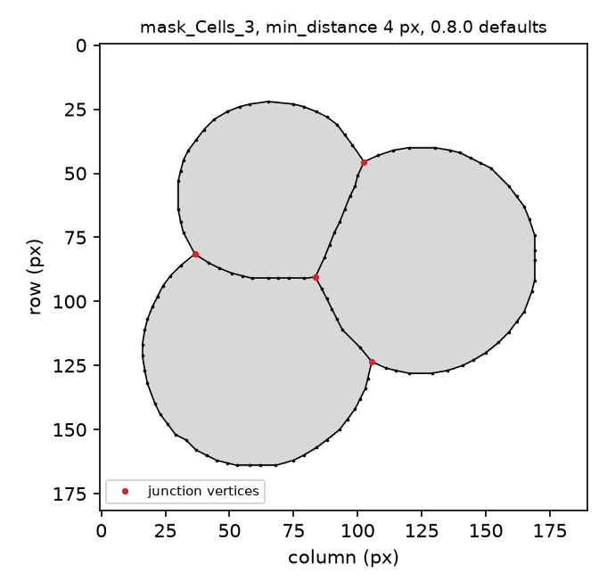

# Two-dimensional masks

dw2d (distribution `delaunay-watershed-2d`) does in 2D what dw3d does in 3D: from a 2-D instance segmentation (an integer label image, 0 for the medium), it builds a **multimaterial polygonal mesh**, one polygonal line per interface between two cells or between a cell and the medium. The method is the same: points are placed on the ridges of the distance map to the cell boundaries, they are triangulated (Delaunay), and a seeded watershed on the triangulation's dual graph gives each triangle a label; the mesh is the set of edges between triangles of different labels. dw2d also builds a half-edge structure of that mesh, from which interface lengths, junction angles, curvatures and cell areas are read.

Since 0.8.0 the two packages are one experience: dw3d's algorithm given a 2-D mask hands it to dw2d, dw2d offers dw3d's names, both write `.rec` files that record their dimension, and dw3d's Polyscope viewer draws either. The input decides the dimension.



*The mesh of the repository's mask `data/two_dimensional/Masks/mask_Cells_3.tif` (182 × 190 pixels, three cells), at the default `min_distance` 4 pixels with every 0.8.0 default, drawn over the mask (cells grey, medium white): each interface a polygonal line (black), its vertices (dots) and the junction vertices, moved onto the mask's own junctions (red). No cell reaches the image border here, so no edge of the mesh lies on it (the border points dw2d marks, `image_border_vertices`, belong to no segment). Made with delaunay-watershed 0.8.0 by `docs/two_dimensional/figures/make_the_two_dimensional_figures.py`.*

## A first 2-D mesh

```py
import tifffile
import dw2d

mask = tifffile.imread("data/two_dimensional/Masks/mask_Cells_3.tif")
algorithm = dw2d.get_default_mesh_reconstruction_algorithm()          # min_distance=4 pixels
points, segments, labels = algorithm.construct_mesh_from_segmentation_mask(mask)
mesh = algorithm.last_constructed_dcel                                # the half-edge structure
lengths, angles = mesh.compute_lengths(), mesh.compute_angles()
algorithm.save_to_rec_mesh("mesh_2d.rec")
```

`dw3d.get_default_mesh_reconstruction_algorithm().construct_mesh_from_segmentation_mask(mask)` gives the same arrays, bit for bit.

## The output

* `points`, `(n, 2)` float64: the vertices, in the mask's index order `(row, column)`, in pixels (the centre of pixel `(i, j)` is the point `(i, j)`), or in the unit of the pixel size with `construct_mesh_in_physical_units(mask, spacing=(h, h))` (square pixels only);
* `segments`, `(m, 2)` int64: indices into `points`;
* `labels`, `(m, 2)` int64: the two materials each edge separates, smaller first. The first label lies on the left of each edge `segments[k, 0] -> segments[k, 1]` in `(row, column)`: each edge is the positively oriented boundary of its first label, the rule dw3d's triangles follow too ([orientation](../user-guide/orientation-in-two-and-three-dimensions.md)).

## Where to go next

* [Reconstruction in 2D](reconstruction.md): every option, its 0.8.0 default and what it was measured to change; the image border and cropped masks; lengths, angles and curvatures.
* [Migrating from dw2d 0.1.5](migration-from-0.1.5.md): the install, the defaults that change results, the fixes, the orientation, the deprecated names.
* [Thin margins of medium](../user-guide/thin-medium-margins.md): the padding of thin margins, in 2D and 3D.
* The notebooks: [geometrical analysis](../examples/two-dimensional-geometrical-analysis.md), [compressing a tissue](../examples/two-dimensional-mask-compression-of-a-tissue.md) and [compressing separated cells](../examples/two-dimensional-mask-compression-of-separated-cells.md).
* The API: [the `dw2d` package](../api/dw2d.md) and its modules.

foambryo infers the tensions and pressures of a 2-D tissue from these meshes, with the same calls as in 3D.
